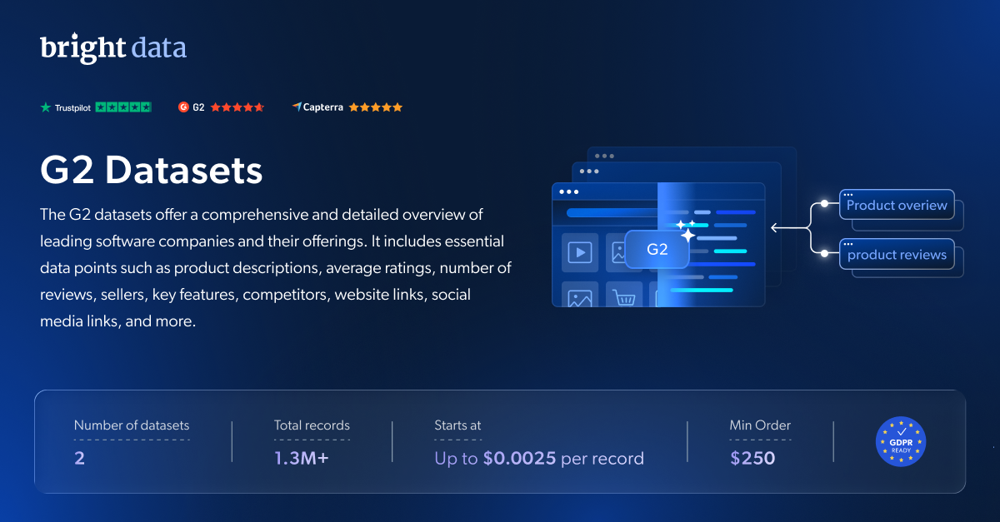

# G2-数据集-样本

<h2>包含 1001 条 G2 软件产品评论的样本数据集</h2>

<a href="https://www.bright.cn/products/datasets/g2">
   
</a>

包含超过 1000 条记录的 G2 软件产品评论数据集样本。该数据集使用 <b>Bright Data API</b> 提取。

<h2>数据集中包含的部分数据点：</h2>

* ```review_id```：评论的唯一标识符
* ```author_id```：评论作者的唯一标识符
* ```author```：评论作者的姓名
* ```position```：作者的职位或角色
* ```company_size```：作者所在公司的规模或类型
* ```stars```：评论给出的星级评分，表示总体满意度
* ```date```：评论发布日期
* ```title```：评论标题
* ```text```：评论的主要内容或正文，提供有关用户体验的详细信息
* ```tags```：与评论相关的标签，表示关键主题或类别
* ```review_url```：特定评论的 URL 或链接
* ```url```：与评论或相关内容关联的另一个 URL
* ```product_url```：被评论软件产品的 URL 或链接
* ```page```：评论在 G2 网站或平台中的页面或位置
* ```product_name```：被评论产品的名称
* ```vendor_name```：产品供应商或提供商的名称
* ```pages```：输入中的页数
* ```sort_filter```：输入中的排序或筛选选项

以及更多内容。

这是“G2 软件产品评论（公开数据）”数据集的样本子集，该完整数据集包含超过 <b>580,000 条记录</b>。

可用的数据集文件格式：<b>JSON、NDJSON、JSON Lines、CSV 或 Parquet。还可选择将文件压缩为 .gz 格式</b>。

数据集交付方式选项：<b>电子邮件、API 下载、Webhook、g2 S3、Google Cloud Storage、Google Cloud PubSub、Microsoft Azure、Snowflake、SFTP</b>。

更新频率：<b>一次性、每日、每周、每月、每季度或自定义周期</b>。

可在提取的数据点之外添加数据丰富服务：<b>根据要求提供。</b>

<b>[获取完整 G2 数据集](https://www.bright.cn/products/datasets/g2)</b>。

<a href="https://www.bright.cn/products/datasets/g2">
   
</a>

<h2>G2 数据集有哪些使用场景？</h2>

<h3>1. 产品分析与竞争基准评估</h3>
利用 G2 数据集评估竞争对手的产品、客户反馈和整体市场定位。此类分析有助于发现市场空白、优化产品功能并调整你的产品，从而更好地满足客户需求并获得竞争优势。

<h3>2. 客户洞察与体验提升</h3>
利用 G2 数据集中的客户反馈和评分，深入了解用户满意度、偏好和痛点。这些洞察能帮助你调整营销策略、优化产品开发并提升客户体验，从而更好地契合客户的期望和需求。

<h3>3. 趋势识别与市场适应</h3>
分析 G2 数据集以识别软件行业的新兴趋势，帮助你预测市场变化，并使产品开发与未来需求保持一致。抢先把握这些趋势，可以让你的企业快速适应变化并保持竞争优势。

<h2>为学术研究人员和非政府组织免费提供网页爬虫工具和数据集</h2>

Bright Initiative 为顶尖学术院系和研究人员，以及致力于推动各种环境与社会事业的非政府组织和非营利组织提供 Bright Data 的 <b>[网页爬虫工具 API](https://www.bright.cn/products/web-scraper)</b> 和 <b>[即用型数据集](https://www.bright.cn/products/datasets)</b>。你可以在<b>[此处](https://brightinitiative.com)</b>提交申请。
